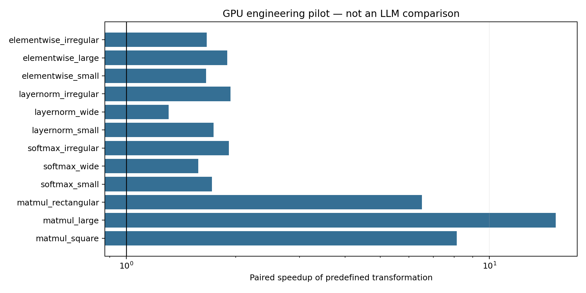
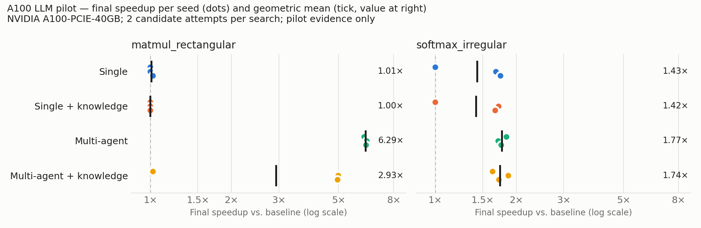

# A100 Pilot (Lonestar6, 2026-11-14)

> Scope correction: this is a configuration-selection control. All 48 proposals used supplied device code. See [the source-generation revision](SOURCE_PILOT_REPORT.md); these effects are not evidence of agents authoring optimized kernels.

Two jobs ran on an NVIDIA **A100-PCIE-40GB** (108 SMs) on TACC Lonestar6,
allocation `ASC26098`, using code commit `0ef781a`.

| Job | Purpose | Ran (CST) | Result |
| --- | --- | --- | --- |
| 3582405 | Engineering pilot: predefined transforms, no LLM | 19:17–19:28 (11 min) | **24/24 evaluations correct** |
| 3582416 | LLM pilot: 2 cases × 4 variants × 3 seeds | 19:28–20:03 (35 min) | **24/24 searches completed**, $0.448 of the $4.49 cap |

An earlier attempt, job 3582290, failed before doing any GPU work. NumPy 2.5.4
raised a spurious `X86_V2` CPU-baseline error on the EPYC 7763 compute node.
The fix (`numpy<2.3`) is in `0ef781a`. Job history:
[`logs/lonestar6_jobs.json`](../logs/lonestar6_jobs.json).

## 1. Engineering pilot (job 3582405)

All 24 baseline and transformation evaluations passed validation:
- the same tolerances as on the laptop;
- five fresh random seeds;
- the edge-case inputs.

| Family | Transformation | A100 paired speedup | RTX 4060 Laptop (v3) |
| --- | --- | ---: | ---: |
| Matrix multiplication | SIMT → tiled tensor-core dot | 6.52–15.23× | 8.28–21.23× |
| Row softmax | Separate → fused | 1.58–1.91× | 1.58–1.93× |
| Layer normalization | Separate → fused | 1.31–1.93× | 1.37–1.85× |
| Bias + ReLU | Two launches → one | 1.66–1.90× | 1.84–3.39× |

**Timing stability.** A100 timing is far more stable than on the laptop:
baseline-versus-itself ratios fell between 0.970 and 1.047, against as low as
0.59 on the laptop.

**Hardware counters.** Nsight Compute is available, and counter access was
verified (`logs/a100/counters-3582405.json`). This removes the main open
question for profiling gate 2.

These transforms are predefined engineering controls, not LLM output.

## 2. LLM pilot (job 3582416)

**Setup.**

| Setting | Value |
| --- | --- |
| Model | `gpt-4.1-mini-2025-04-14` |
| Cases | `matmul_rectangular`, `softmax_irregular` |
| Seeds | 11, 22, 33 |
| Budget per search | 2 candidate attempts, 8 model calls |

- All 24 searches stopped at the candidate cap. None were interrupted or
  excluded.
- The cluster-side analysis was reproduced bit-for-bit locally.

| Case | Variant | Seed 11 | Seed 22 | Seed 33 | Geometric mean |
| --- | --- | ---: | ---: | ---: | ---: |
| matmul_rectangular | Single | 1.00 | 1.00 | 1.02 | 1.01 |
| | Single + knowledge | 1.00 | 1.00 | 1.00 | 1.00 |
| | Multi-agent | 6.20 | 6.35 | 6.31 | **6.29** |
| | Multi-agent + knowledge | 1.02 | 4.97 | 4.95 | 2.93 |
| softmax_irregular | Single | 1.00 | 1.68 | 1.74 | 1.43 |
| | Single + knowledge | 1.00 | 1.71 | 1.67 | 1.42 |
| | Multi-agent | 1.84 | 1.71 | 1.75 | **1.77** |
| | Multi-agent + knowledge | 1.63 | 1.87 | 1.72 | 1.74 |

**Overall geometric mean by variant** (both cases):

| Variant | Geometric mean |
| --- | ---: |
| Single | 1.20 |
| Single + knowledge | 1.19 |
| Multi-agent | 3.33 |
| Multi-agent + knowledge | 2.26 |

**Paired effects.** Ratios of geometric means; a value above 1 means the
first variant is better.

| Effect | Ratio |
| --- | ---: |
| Roles, without knowledge (multi / single) | 2.78× |
| Knowledge, single agent | 0.99× |
| Roles, with knowledge | 1.89× |
| Interaction | 0.68× |

The 95% bootstrap intervals in `aggregate.json` are **not informative**. With
only two case clusters, a case-level bootstrap can produce just three distinct
resamples. Report the point estimates, and do not quote these intervals as
uncertainty.

### Mechanism: what the agents actually changed

**No code edits.** Every proposal, valid or invalid, was a configuration
change. Every candidate kept the baseline device source (hash `abd6dea4`). In
this pilot, an agent's success came down to whether it turned on one existing
switch.

**matmul_rectangular.** The entire gain comes from setting `tensor_core=True`.
The retained kernel runs at about 0.031 ms, close to the PyTorch library
reference at about 0.030 ms. The baseline runs at about 0.197 ms.

| Variant | Searches that enabled tensor cores |
| --- | ---: |
| Multi-agent | 3 of 3 |
| Multi-agent + knowledge | 2 of 3 |
| Single | 0 of 3 |
| Single + knowledge | 0 of 3 |

The single-agent runs instead varied block sizes, warps and stages. None of
those settings beat the baseline by the required 1.01×.

**softmax_irregular.** Every retained improvement sets `fused=True`. Single
and single + knowledge both missed it at seed 11.

**Invalid proposals.** 9 of the 48 attempts were configurations the harness
rejected, for example a missing required key:

| Variant | Invalid proposals |
| --- | ---: |
| Single | 2 of 12 |
| Single + knowledge | 2 of 12 |
| Multi-agent | 3 of 12 |
| Multi-agent + knowledge | 2 of 12 |

Each invalid proposal still uses up one of the attempts.

**Token use.** Totals per variant:

| Variant | Tokens |
| --- | ---: |
| Single | 211,903 |
| Single + knowledge | 255,050 |
| Multi-agent | 231,818 |
| Multi-agent + knowledge | 274,586 |

Knowledge cards add about 20% more input tokens.

### Interpretation

- **What the pilot shows.** On matmul, the specialist multi-agent prompts
  consistently found the tensor-core switch, and the general single agent
  never did. This is the first role-related signal seen in the project, and it
  is large.
- **Why it is not yet a study result.**
  - It covers 2 cases with only 2 attempts per search.
  - The matmul gain is a single binary decision. The proposal's baseline
    deliberately avoids tensor cores, which leaves large headroom.
  - A longer budget (20 attempts) may let single agents find the same switch.
- **Knowledge did not help.** Supplied knowledge did not help the single
  agent. In one multi-agent seed it was associated with missing the
  tensor-core switch. Why requires reading the transcripts
  (`*/events.jsonl`).

### Implications for the primary study

1. **Measure the effect of predefined switches.** When the search space
   includes switches like `tensor_core` and `fused`, results largely measure
   whether an agent flips a known switch. Report the effect of each switch
   separately. Also consider whether the frozen protocol should include tasks
   that need real code edits.
2. **Plan the budget.** At about $0.019 per search with 2 attempts, the full
   study (144 searches × 20 attempts) would cost roughly 144 × $0.19 ≈ **$27**,
   plus ablations. That is above the original $5 pilot allowance. Approve a
   budget before running it.
3. **Count invalid proposals.** About 19% of attempts are invalid; track this
   as its own outcome.

## Raw evidence

| Path | Contents |
| --- | --- |
| `results/a100_pilot_3582405/` | Per-case requests and results, kernel snapshot, events, manifest |
| `results/a100_llm_pilot_3582416/` | 24 search directories: prompts and responses (`events.jsonl`), candidates, measurements, `summary.json`; campaign manifest; cost ledger |
| `reports/a100_pilot_3582405/` | `pilot.csv`, `validation_summary.json`, plot |
| `reports/a100_llm_pilot_3582416/` | `runs.csv`, `aggregate.json`, `cost.json`, `search_curves.png`, `speedup_by_variant.png` |
| `logs/a100/` | Slurm output, environment freeze, `nvidia-smi`, Nsight counter probes |
