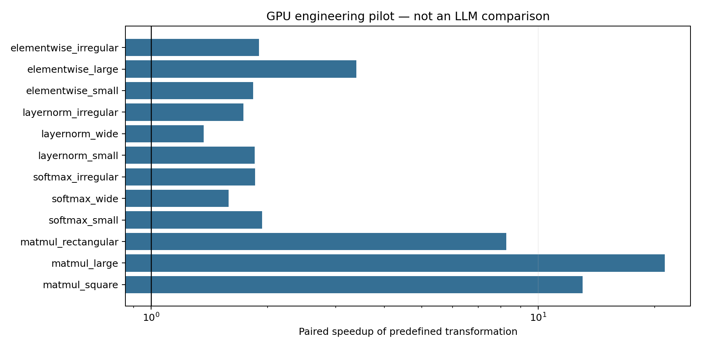

# Local GPU Engineering Pilot (2026-11-14)

**Headline.** The corrected implementation passed **24/24** baseline and
transformation evaluations across all 12 cases on a local **RTX 4060 Laptop
GPU**.

**Validation per evaluation.**

- five fresh random seeds;
- zero, constant, large-magnitude and negative edge-case inputs;
- the original numerical tolerances;
- checks that inputs are not modified and that outputs are fully written.

This is development evidence, not the planned A100 study.

## Results

The reproducible cohort is `results/local_pilot_v3`. Its manifest records the
kernel snapshot, code hashes, environment and timing protocol.

**Timing.**

- 31 samples after warm-up, each of 10 inner repetitions.
- Candidate and baseline run in alternating order.
- Each apparent gain is confirmed with a second measurement.

| Family | Transformation | Paired speedup |
| --- | --- | ---: |
| Matrix multiplication | SIMT → tiled tensor-core dot | 8.28–21.23× |
| Row softmax | Separate statistics/application → fused | 1.58–1.93× |
| Layer normalization | Separate statistics/application → fused | 1.37–1.85× |
| Bias + ReLU | Two launches → one fused launch | 1.84–3.39× |

**Interpretation.**

- These transformations were predefined engineering controls. They are
  **not LLM-generated** and say nothing about specialist roles or supplied
  knowledge.
- Matmul gains are measured against the proposal's simple baseline, which
  does not use tensor cores. They are not measured against cuBLAS or PyTorch;
  library latency is reported separately in the CSV files.

## A failure we found and fixed

**What failed.** The exploratory cohort `local_pilot_v2` passed 23 of 24
evaluations. Fused layer normalization at shape `[513, 781]` failed on the
constant-input edge case. The maximum absolute error was about `3.99e-5`,
against a tolerance of `2e-5`.

**Cause.** Approximate division in the mean left a small residual, and
normalization amplified it.

**Fix.** Both layer-normalization kernels now compute the mean with Triton's
round-to-nearest division, `tl.div_rn`. With the same tolerances and edge
tests, v3 passed.

**Record kept.**

- The rejected output, traceback and original results are all preserved.
- No failed candidate was reported as correct.
- The tolerance was not relaxed.

## Measurement limitations

- **Shared laptop GPU.** The GPU also drives the Windows desktop. Clock
  changes, display work and WSL launch overhead make timing less stable.
  - One baseline-versus-itself comparison in v2 came out at about 0.59×.
  - Most v3 self-comparisons were close to 1 but still varied.
  - The raw samples should be used, and the measurements repeated on an
    allocated A100.
- **What the timing covers.** CUDA-event timing of repeated eager launches can
  include GPU idle time while the host submits work. The numbers describe this
  launch path, not isolated hardware throughput.
- **Profiling limits.** Compiler register and shared-memory reports are
  available. Hardware-counter access is unverified, so no counter-based
  bottleneck diagnosis or roofline fraction is claimed.
- **v2 instrumentation.** v2 ran while reporting instrumentation was still
  changing. v3 is the reproducible cohort with fixed candidate source.

## Remaining work

**Separate pilots.** The real-model pilot is reported separately in
[`LLM_SMOKE_REPORT.md`](LLM_SMOKE_REPORT.md). Lonestar6 job 3582290 had not
yet produced an A100 result when this report was written.

**Still to do.**

1. Freeze the protocol after the A100 pilot.
2. Run the full 144-search study.
3. Run targeted ablations.
4. Complete the hardware-specific headroom analysis.
5. Write the final scientific report.
