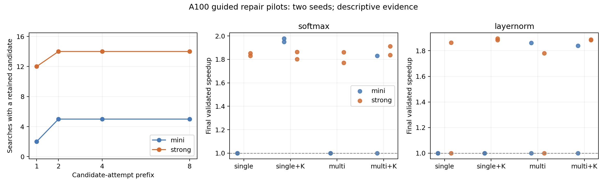

# Completed guided reduction pilots — 2026-11-15

**GPT-4.1 passed the predeclared readiness rule; mini did not.** The larger
model produced fresh-validated, faster authored kernels in 14/16 searches,
versus 5/16 for mini. Longer searches exposed correctness repairs, but new
retention mostly stopped after attempt 2. These are development pilots,
not a completed primary study or proof of a roles/knowledge advantage.

## Completion and integrity

| Job | Model snapshot | Start/end (CST, Nov 15) | Elapsed | Outcome |
| --- | --- | --- | --- | --- |
| 3584053 | gpt-4.1-mini-2025-04-14 | 13:55:07–15:09:08 | 1:14:01 | COMPLETED, exit 0:0 |
| 3584057 | gpt-4.1-2025-04-14 | 15:09:19–16:28:38 | 1:19:19 | COMPLETED, exit 0:0 |

Both allocations ran on v330-012, NVIDIA A100-PCIE-40GB, Torch 2.11.0+cu128,
Triton 3.6.0, CUDA 12.8. Frozen experiment checkout: `0d0fd71`.
Each phase contains exactly two FP32 [513,781] cases, four arms, seeds 11/22,
eight candidates and 32 model calls per search: **16 searches, 128 attempts,
512 calls per model**, with no missing or budget-censored cells.

The local reanalysis checked the expected matrix, completion/cap reasons,
per-response token accounting, final validation coverage, and matching
baseline/case/knowledge/code hashes. Only the model and its input/output
prices differ between paired protocols. Both cluster repair reports were
recomputed locally and match exactly. All 32 final selections passed the
five fresh random seeds and four edge cases; baseline fallbacks count as
1.0x, not authored successes. Slurm stderr files are empty.

Download archive: 909,088 bytes, SHA256
`2b404bd450cf13070cdb4ddf79d29933e4ef2de7f0840772081eeb0877c1fb77`.
The hash was checked before extraction. Raw prompts, responses, candidate
source, validation, timings, manifests, phase decisions and logs are retained.

## Results

Speedup is relative to the frozen project baseline, with all baseline
fallbacks included in geometric means.

| Metric | Mini | GPT-4.1 |
| --- | ---: | ---: |
| Final authored improvements | 5/16 | 14/16 |
| Softmax improvements | 3/8 | 8/8 |
| Layernorm improvements | 2/8 | 6/8 |
| Geometric mean speedup, all searches | 1.220x | 1.714x |
| Softmax geometric mean | 1.277x | 1.841x |
| Layernorm geometric mean | 1.166x | 1.596x |
| Correct attempts | 34/128 | 49/128 |
| Proposal-policy errors | 35 | 20 |
| Compile/runtime errors | 40 | 36 |
| Incorrect outputs | 19 | 22 |
| Timeouts | 0 | 1 |
| Estimated inference cost | $1.9153828 | $10.4175000 |

The readiness rule required at least 6/8 final authored improvements **for
each case**. Mini's failure triggered the conditional GPT-4.1 phase as
declared. GPT-4.1 met both thresholds. Its aggregate matched speedup ratio
over mini is 1.405x, at 5.44x the estimated inference cost.

| Arm | Mini successes / 4; geometric mean | GPT-4.1 successes / 4; geometric mean |
| --- | --- | --- |
| Single | 0; 1.000x | 3; 1.586x |
| Single + knowledge | 2; 1.401x | 4; 1.861x |
| Multi | 1; 1.168x | 3; 1.556x |
| Multi + knowledge | 2; 1.355x | 4; 1.880x |

Knowledge arms look more reliable in this tiny sample; role effects are
mixed. Two cases and two seeds cannot establish general benefits or useful
case-level uncertainty. Both models had the same guidance; this comparison
does not isolate the effect of adding that guidance. Model phases ran
sequentially on the same node, so temporal conditions remain a limitation.



All individual cells and library timings are in
[runs.csv](repair_round_comparison/runs.csv). GPT-4.1 softmax candidates are
1.77–1.91x faster than the project baseline but **slower than the measured
library reference**: library/candidate timing ratios are 0.759–0.840.
The six retained layernorm candidates have library/candidate ratios
1.450–1.610. These are measured implementation comparisons, not claims of
state-of-the-art kernels or hardware utilization.

## What eight attempts revealed

| Prefix | Mini searches with a retained candidate | GPT-4.1 searches with a retained candidate |
| --- | ---: | ---: |
| 1 | 2 | 12 |
| 2 | 5 | 14 |
| 4 | 5 | 14 |
| 8 | 5 | 14 |

Two searches per model found their first correct candidate after attempt 2.
Mini first reached those successes at attempt 6; GPT-4.1 at attempts 3 and 4.
None yielded its first retained speedup after attempt 2. Nine mini and 13
GPT-4.1 searches contain a failure-to-correct transition. These temporal
counts do not by themselves prove that the next source repaired its parent.
Only final selections received independent fresh validation; prefix counts
are search-history observations.

One GPT-4.1 search (`layernorm_irregular_single_22`) retained a later upgrade
at attempt 8. Its paired candidate/incumbent medians were 0.018944/0.019968 ms
(about 1.054x); it passed the existing repeated acceptance check and finished
at 1.863x versus baseline. All other final retained candidates came from
attempts 1–2. Attempts 3–8 used $1.5820492 of mini's cost and $8.710316 of
GPT-4.1's cost (about 83% in each phase), with limited performance return.
This motivates broader replication and better diagnostics before simply
increasing every search to 20 attempts.

## Source inspection and unresolved failures

All 256 attempts supplied source. Gate v2 accepted structural edits for 93
mini and 108 GPT-4.1 candidates; all 20 retention events across the phases
use one launched kernel. Inspected softmax code fuses masked load, row max,
exponentiation, sum and output in one device kernel. This changes device
computation and launch structure, rather than selecting predefined tuning
parameters. Static features alone do not prove performance causality.

A concrete repair appears in GPT-4.1 `layernorm_irregular_single_22`:
attempt 1 failed constant-input validation (maximum absolute error about
4.61e-5). Attempt 2 changed the full-row reduction/affine implementation,
used `tl.div_rn` for mean and variance, passed validation and was retained.
The source and failure feedback support a real repair; its rationale's
claim of a coverage bug is not independently established for BLOCK=1024.

Its attempt 8 switches to E[x^2]-E[x]^2 and a tail accumulation path. The
claimed two-BLOCK unrolling is inactive at N=781, BLOCK=1024: the main loop
has zero iterations. Do not attribute its measured gain to that unrolling.
The variance formula warrants large-offset/small-variance stress tests.
It passed the frozen final suite, including a maximum negative-edge error
of 1.34e-5; broader numerical robustness has **not** been established.

The two GPT-4.1 baseline fallbacks are layernorm `single_11` and `multi_11`.
Each eventually produced three correct candidates; none met the speedup
acceptance rule. Their paths retained separate statistics/apply launches,
with intervening constexpr, shape and numerical failures. Thus these are
optimization failures after partial correctness recovery, not searches
that never wrote correct code. Representative multi attempt 4 uses a
two-kernel statistics/apply implementation.

Recurring failures include non-constexpr/non-power-of-two ranges, invalid
tensor slicing/control flow, malformed launch arguments and masked-output
coverage. Separate policy rejections from language errors: for example,
`tl.uint32` is rejected by the current allowlist. Do not label every
unsupported-by-policy primitive a hallucinated API. Inspect the allowlist
before interpreting aggregate model error counts as pure capability.

## Local smoke and cost reconciliation

The separate RTX 4060 smoke is now complete: 4/4 searches, four attempts each,
$0.2054376. Only multi + knowledge retained an authored softmax candidate
(1.9003x); the other three retained baselines. Laptop timings are not pooled
with A100 results. The earlier partial checkpoint is superseded.

| Ledger item | Estimated USD |
| --- | ---: |
| Previously completed experiments | 0.8739192 |
| Completed local guided smoke | 0.2054376 |
| Completed mini A100 round | 1.9153828 |
| Completed GPT-4.1 A100 round | 10.4175000 |
| **Total completed** | **13.4122396** |
| **Remaining under $25 approval** | **11.5877604** |

These are usage-derived estimates at the frozen token prices, ignoring
cached-input discounts, not a billing-statement reconciliation. Completed
reservations are released; no additional inference was requested during
this analysis. No new job was submitted.

## Next steps

1. Run additional numerical stress checks on all existing final layernorm
   kernels, and inspect/profile actual executed source paths. No API spend.
2. If the frozen protocol survives that audit, replicate both reductions
   with GPT-4.1, seed 33, all arms and eight attempts (8 searches, $5.50 cap).
3. Then test matmul_rectangular and elementwise_irregular with the same
   protocol, seed 11 and all arms (8 searches, $5.50 cap). Reconcile spending
   between stages; preserve a $0.5877604 reserve. These are plans, not launches.
4. Version any validation/gate changes and start a separately matched cohort;
   do not silently pool changed protocols. Plan the 12-case primary study
   and ablations separately: its 2,880 attempts alone extrapolate to about
   $234.39 at current observed cost, before longer-context growth.

Detailed plan: [`main:docs/NEXT_EXPERIMENT_PLAN.md`](https://github.com/Lingxiao-Yang/multi-agent-kernel/blob/main/docs/NEXT_EXPERIMENT_PLAN.md).
The infrastructure and source-generation pilots are established, but the
full primary matrix, ablations and generalization evidence remain unfinished.

## Reproduction and records

With code from `main` and the two raw phase directories from `results`:

```powershell
python scripts/compare_repair_rounds.py --mini results/repair-mini-3584053/campaign --strong results/repair-strong-3584057/campaign --output reports/repair_round_comparison
```

- [Machine-readable comparison](repair_round_comparison/comparison.json)
- [Failure excerpts](repair_round_comparison/failure_examples.json)
- [Step journal](../logs/repair_round_steps.jsonl)
- [Job ledger](../logs/lonestar6_jobs.json)
- [Budget ledger](../logs/pilot_budget_checkpoint.json)
- Raw outputs: `results/repair-mini-3584053`, `results/repair-strong-3584057`.
