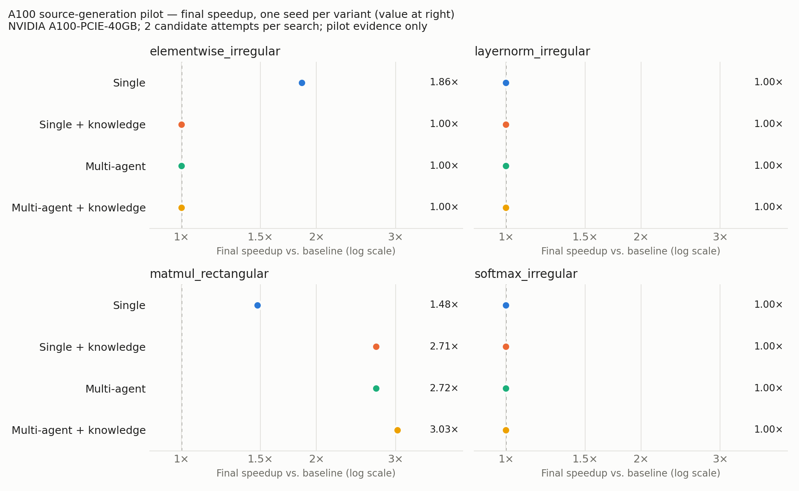

# Source-generation pilot and experiment revision

The original A100 model pilot (job 3582416) made 48 configuration-only
proposals. Its gains selected supplied implementations. It remains a
parameter-selection control and does not establish that agents can write
optimized kernels.

The revised search presents only the current family's baseline source.
Agents author complete Triton kernels and declarative launch sequences;
function names, signatures and launch boundaries may change. There are no
predefined fusion or tensor-core switches in this search space. The trusted
reference, validator, allocator and timing code remain outside model control.

## Completed local source smoke

- GPU: NVIDIA GeForce RTX 4060 Laptop GPU (development evidence only).
- Model: gpt-4.1-mini-2025-04-14; temperature 0.7.
- Two cases x four variants x seed 11; one candidate and four calls per search.
- Eight searches completed, 32 actual model calls, 108,331 input tokens and
  16,403 output tokens; estimated cost **$0.0695772**.
- Two proposals passed correctness and were retained. Final validation used
  five fresh random inputs plus four edge cases; baseline fallback passed in
  all six unsuccessful searches.

| Case | Single | Single + knowledge | Multi | Multi + knowledge |
| --- | ---: | ---: | ---: | ---: |
| matmul_rectangular | 2.310x | 1.827x | 1.000x | 1.000x |
| softmax_irregular | 1.000x | 1.000x | 1.000x | 1.000x |

These are final paired measurements. The local display GPU is noisy, the
attempt budget is only one, and there are no repeated seeds. Do not infer a
general role or knowledge effect. The analysis JSON's two-case bootstrap
intervals are not useful uncertainty estimates and should not be quoted.

## Source-level mechanisms and failures

| Proposal | What the actual source does | Outcome |
| --- | --- | --- |
| Matmul, single | Replaces scalar K accumulation with tile loads and tl.dot | Correct; retained at 2.310x |
| Matmul, single + knowledge | Adds tiled tl.dot with next-tile loads before current-tile computation | Correct; retained at 1.827x; source ordering alone does not prove hardware overlap |
| Matmul, multi | Attempts explicit shared-memory buffering using unsupported tl.shared_memory | Policy rejection |
| Matmul, multi + knowledge | Attempts a different tiled pipeline; malformed tl.zeros shape | Compilation failure |
| Softmax, multi + knowledge | Authors one fused row-reduction/output kernel | Compilation failure: tl.arange extent 781 is not a power of two |
| Other three softmax proposals | Rearrange temporaries and change grids, block sizes or scalar arguments | Numerical failures: incomplete coverage and/or truncated reductions |

Thus five proposals attempt algorithmic or execution-structure changes,
including both successful matmuls and the failed fused softmax. Three remain
parameter tuning dressed as source edits. We do not count those three as
substantive kernel optimization.

The initial structural screen passed seven proposals, exposing a weakness:
introducing temporaries changes the AST without changing the algorithm.
**Gate version 2** in main normalizes straight-line temporaries, associative
grouping and equivalent call argument spelling. Offline replay rejects all
three cosmetic softmax rewrites and still permits both validated matmuls.
The unsupported API remains rejected. This replay does not change the original
search outcomes, charge new model calls or generate new GPU measurements.
It remains a conservative screen rather than a semantic equivalence proof;
manual inspection of retained source remains required.

Raw data: [local source smoke](../results/local_source_smoke_v1/).
Audit: [candidate source audit](local_source_smoke_v1/source_audit.json),
[gate replay](local_source_smoke_v1/gate_v2_replay.json).

## A100 source pilot (job 3582814) — completed

Lonestar6 job **3582814** ran on one A100-PCIE-40GB (node v330-016,
allocation ASC26098) at frozen commit `ea03292` with the original structural
gate. It was submitted at 21:51:31 CST, started at 21:57:22 (queue wait
351 s) and finished at 22:25:13 with exit code 0 (27 min 51 s).

- **Preflight:** all 12/12 baseline-interface checks passed before inference
  ([source-preflight-3582814](../results/source-preflight-3582814/)).
- **Campaign:** four irregular cases × four variants × seed 11, with 2
  candidate attempts and 8 model calls per search. All 16 searches stopped at
  the candidate cap; none were excluded.
- **Model and cost:** `gpt-4.1-mini-2025-04-14`, 128 calls, 542,393 input and
  65,922 output tokens, estimated **$0.3224** of the $1.25 ceiling.

| Case | Single | Single + knowledge | Multi | Multi + knowledge |
| --- | ---: | ---: | ---: | ---: |
| matmul_rectangular | 1.476x | 2.714x | 2.717x | **3.027x** |
| elementwise_irregular | **1.856x** | 1.000x | 1.000x | 1.000x |
| softmax_irregular | 1.000x | 1.000x | 1.000x | 1.000x |
| layernorm_irregular | 1.000x | 1.000x | 1.000x | 1.000x |

Every retained kernel passed final validation on the five unseen seeds
(10001–10005) and the zero, constant, large and negative edge inputs. With
one seed and four case clusters, the variant geometric means (1.29, 1.28,
1.28, 1.32) and bootstrap intervals in `aggregate.json` are not evidence of a
role or knowledge effect and should not be quoted.

### What the retained kernels actually do

All five retained candidates are first attempts. Each one is an authored
source change, not a configuration switch; the offline gate-v2 replay keeps
all five.

| Search | Source change | Launch | Candidate / baseline / library (ms) |
| --- | --- | --- | --- |
| Matmul, single | Replaces the scalar-K outer-product loop with K-tiled `tl.dot`, manually unrolled two tiles per iteration | 16×16×64 tiles, 8 warps | 0.132 / 0.195 / 0.031 |
| Matmul, single + knowledge | K-tiled `tl.dot` | 32×32×32, 8 warps | 0.072 / 0.195 / 0.031 |
| Matmul, multi | K-tiled `tl.dot` (renamed kernel) | 32×32×32, 8 warps | 0.072 / 0.196 / 0.033 |
| Matmul, multi + knowledge | K-tiled `tl.dot` (renamed kernel) | 32×32×64, 4 warps | 0.065 / 0.195 / 0.037 |
| Elementwise, single | Fuses bias-add and ReLU into one kernel, two launches → one | 256-element blocks, 8 warps | 0.020 / 0.037 / 0.019 |

- **Matmul.** All four variants found the same algorithmic change. The
  differences in speedup (1.48× to 3.03×) come from tile shape and warp count,
  not from different algorithms. Operands are cast to fp32 before `tl.dot`;
  under Triton's default this uses TF32 tensor-core math on A100. The
  retained kernels remain about 2–4× slower than the PyTorch library reference.
  The single agent's "double buffering" comment describes a two-tile unroll,
  not asynchronous prefetching.
- **Elementwise.** The fused kernel matches the library reference
  (0.020 vs 0.019 ms). The other three variants did not produce a correct
  fused kernel.
- **Second attempts.** All four matmul second attempts were rejected by the
  policy gate (two cosmetic rewrites, one unsupported `tl.shared_memory`, one
  Python object mutation), so each matmul result rests on one proposal.

### Failures

27 of the 32 attempts failed:

| Outcome | Count | Typical cause |
| --- | ---: | --- |
| Incorrect output | 10 | Softmax and layernorm on irregular width 781: blocks that do not cover the row, giving 99.8–100% mismatched elements |
| Compilation error | 7 | `tl.arange` with a non-constexpr or non-power-of-two extent (6 of 7); a Python loop outside JIT |
| Rejected by the policy gate | 10 | Cosmetic rewrites (3), invalid launch argument (3), Python object mutation (2), unsupported `barrier` / `shared_memory` (2) |

| Variant | Correct | Incorrect | Compile error | Gate rejection |
| --- | ---: | ---: | ---: | ---: |
| Single | 2 | 0 | 1 | 5 |
| Single + knowledge | 1 | 5 | 1 | 1 |
| Multi | 1 | 3 | 2 | 2 |
| Multi + knowledge | 1 | 2 | 3 | 2 |

No variant produced a correct softmax or layernorm kernel. The dominant
obstacle is handling a non-power-of-two row width in Triton, which the
knowledge cards did not prevent.

### Offline gate-v2 replay

Replaying `main`'s gate version 2 (commit `8e8f4bc`) over all 32 proposals
changes three decisions relative to the original screen: three softmax
proposals (multi attempt 1, single + knowledge attempts 1 and 2) are cosmetic
rewrites that the original gate passed and gate v2 rejects. All three were
already incorrect, so **no search outcome changes**. The replay re-runs no GPU
measurements and charges no model calls.

Raw data: [results/a100_source_pilot_3582814](../results/a100_source_pilot_3582814/).
Audit: [source_audit.json](a100_source_pilot_3582814/source_audit.json),
[source_candidates.csv](a100_source_pilot_3582814/source_candidates.csv),
[gate_v2_replay.json](a100_source_pilot_3582814/gate_v2_replay.json).
Slurm output: [`logs/a100/source-pilot-3582814.out`](../logs/a100/source-pilot-3582814.out).

### Cohorts

The 24-search configuration-selection control (job 3582416), the local source
smoke, and this A100 source pilot are distinct cohorts. Never pool their
timings or treatment effects. New gate-v2 runs must also be identified
separately.

## Validation and remaining work

37 CPU integrity tests pass. The local four-family interface preflight and
A100 twelve-case preflight passed. Raw proposals, failures, source hashes,
model usage, latency samples and final-validation records are preserved.

The completed A100 source pilot shows that `gpt-4.1-mini` authors correct
tiled matmuls reliably but fails irregular-width reductions. The next decision
uses its authorship, repair success and cost. It should determine whether to improve shared API guidance
or use a stronger pinned model before freezing the main experiment. The
144-search primary matrix, repeated seeds, targeted role/category ablations,
and final hardware-headroom report remain outstanding. This checkpoint does
not establish 67% completion of the proposed empirical study.
